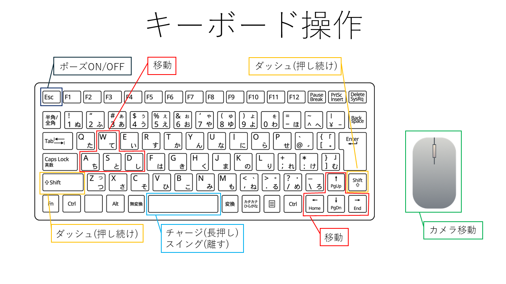
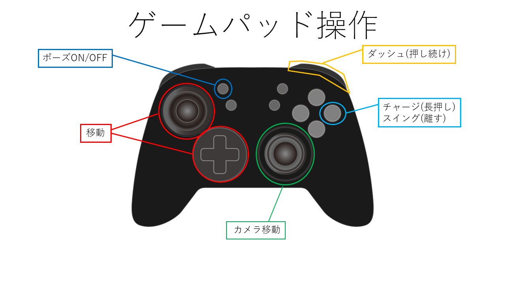

製作者：Soldval  
Soldvalは「ソルドバル」と読みます。名前に深い意味はありません！

## 🕹️ 作品タイトル
**FREE SWINGER**  
**～目指せMVP級の暴れ打者！～**

野球のバッティングをメインにした、爽快スコアアタック3Dアクションゲームです！！

FreeSwingerとは、どんな球でも豪快にスイングしてしまう打者のことです。
三振が多い分、当たればほぼホームランという大味なイメージがあります。
転じてこのゲームではとにかく何にでもスイングするという意味でこのタイトル名にしました。

## 📽️ ゲーム紹介

https://github.com/user-attachments/assets/1dbd341d-7c0b-4eda-bf08-3d0aad943ef4

* ゲーム開始したらとにかく周りのモノを打ちまくって高スコアを目指します(一部飛ばせないモノもあります)。
* チャージの長さによって通常スイング/チャージスイングに切り替わります。チャージスイングの方が大きくモノを飛ばせます。
* 打ったモノが他のモノを巻き込んで破壊すると更にスコア追加となります
* 高スコアで「MVPスラッガー」を目指しましょう！
## 🎮 操作方法  
本ゲーム操作は「キーボード」または「ゲームパッド(Nintendo Switch Proコントローラー等)」両方に対応しています。

| アクション | キーボード | ゲームパッド(Proコントローラー等) |
| :--- | :--- | :--- |
| **移動** |`WASDキー` または `↑←↓→キー`|`左スティック` または `左十字ボタン`|
| **ダッシュ** |`Shiftキー`（押し続け）|`Rボタン`（押し続け）|
| **チャージ開始** |`Spaceキー`（長押し）|`Aボタン`（長押し）|
| **バットスイング開始** |`Spaceキー`（離す）|`Aボタン`（離す）|
| **カメラ操作** |`マウス移動`|`右スティック`|
| **ポーズ** |`Escキー`|`⊖ボタン`(Selectボタン)|

## 🤖 プレイ方法
ビルド済みの実行ファイルは以下からダウンロード可能です。
※Windows環境でプレイ可能です

### 起動手順
1. 上記リンクから ZIP ファイル（約〇〇MB）をダウンロードします。
2. ダウンロードした ZIP ファイルを任意のフォルダに**すべて展開（解凍）**します。
3. 展開されたフォルダ内の **`FreeSwinger.exe`** をダブルクリックして起動します。

## 🎯こだわったポイント
### 分かりやすいUI・操作性
直感的に分かりやすいデザインや操作性を意識しました。タイトル画面などのボタンはシンプルかつ一目で分かりやすい大きさで配置しました。操作性もなるべくシンプルでプレイヤーが迷わないような設定にしました。

### 見やすいスクリプト
他者や未来の自分が見ても分かりやすいスクリプトを意識しコーディングしました。具体的には、意味が伝わりやすい変数名・処理名、適切なコメント、まとまりのある処理群などで可読性向上に努めました。

## 💭 設計・構想資料
開発前に作成した企画書や構想資料は、以下よりご覧いただけます。
* [FreeSwinger 企画書はこちら（PDF）](./Documents/FreeSwinger_企画書.pdf)
* [FreeSwinger 構想資料はこちら（PDF）](./Documents/FreeSwinger_構想資料_PDF.pdf)
* [FreeSwinger 構想資料はこちら（Excel ダウンロード）](./Documents/FreeSwinger_構想資料.xlsx)
* [FreeSwinger スクリプト簡易説明表はこちら（PDF）](./Documents/FreeSwinger_スクリプト簡易説明表.pdf)
* ※スクリプトは「Assets/01_Scripts」内にまとめてあります。

## 📜 制作意図
### 1. コンセプトとコア体験
本作のメインターゲット層は10代～30代の人です。簡単操作と明解なルールで自由に3Dアクションを楽しんでもらうゲームを目指しました。  
* **コア体験:**「フィールドを縦横無尽に駆け巡り、身の回りにあるモノにスイングして飛ばす・破壊する、そして高スコアを目指す。」  
直感的な面白さと爽快感をプレイヤーに届けることを意識しました。

### 2. 「スイングアクション」を題材に選んだ理由 
野球は「バットでボールを打つ」だけでも楽しいスポーツですが、ゲームにする際、「ボールだけでなく、箱でも何でも自由に打てる方がアクションゲームとしての幅が広がる」と考えました。
さらに、打ったモノを別のモノにぶつけ連鎖的に破壊する要素も加わると、より高いアクション性が出て面白さに繋がると思いました。  
以上の理由から、自由に動き打つ・破壊するのスイングアクションを題材に選択しました。

### 3. 構想資料を作成した2つの理由
#### ① ゲームプログラマーの職務を意識したため
ゲームプログラマーの仕事は、コード記述だけでなく、企画書や仕様書、構想書類などの資料作りも重要な仕事スキルだと考えています。  
私はゲーム業界未経験者ですが、現職の業務経験を活かし、自分なりにゲームプログラマーの仕事を意識した上で構想資料を作成しました。
#### ② 開発中の迷いを無くし完成させるため
アイデアが未完成の状態でコードを書き始めると、開発途中で方向性にズレが生じたり、ゴールが見えなくなるリスクが高まります。  
あらかじめ全体像の資料としてまとめたことにより、プログラミング作業での迷いを最小限に抑え完了の姿を把握することができました。

## 📆 制作期間
| 項目 | 目安期間 | 実作業期間 |
| :---: | :---: | :---: |
| 大まかな構想 | 2週間程(4月頭～4月中旬程) | 2週間程(4月頭～4月中旬程) |
| 構想/詳細設計 | 1カ月程(5月頭～5月末程) | 1.5カ月程(5月頭～6月中旬程) |
| 実ゲーム制作 | 5カ月程(6月頭～10月末程) | 4.5カ月程(7月頭～11月中旬程) |  

* 大まかな構想では、どんなゲームを作るのか？何で作るのか？などの大体の構想を決めました。目安期間通りでした。  
* 構想/詳細設計では、企画書や構想資料を作成しました。仕事の出張などもあり目安期間よりも日がかかりました。
* 実ゲーム制作では、構想資料などを基に作成しました。仕事の出張などを考慮し目安期間を多く見積もりました。可能な限り平日の帰宅後や休日をゲーム作成時間に充て、なんとか11月中に作り上げました。

## 💻 制作環境
* 使用機材
  * モバイルモニター(I-O DATA製)
  * PCマウス(ELECOM製)
* 使用ノートPC
  * ノートPC名：GALLERIA RL7C-R55-C5N
  * CPU：intel Core i7-14650HX(最大5.2GHz/16コア/24スレッド)
  * GPU：NVIDIA GeForce RTX 5050 8GB Laptop GPU + intel UHD graphics(CPU内蔵)
  * RAM：32GB(16GB×2)(DDR5-4800 SO-DIMM)
  * ストレージ：1TB SSD(M.2 NVMe Gen4)
  * OS：Windows 11 Home 64bit
* 使用ソフト
  * ゲームエンジン：Unity 6000.3.17f1
  * コード作成ソフト：Visual Studio Community 2026
  * バージョン管理ツール：GitHub/Sourcetree
  * 生成AIツール：Gemini
  * デザイン作成ツール：Canva
  * デザイン透明化ツール：Adobe Express, Remove.bg
  * 画像圧縮ツール：あっしゅくま
  * 動画編集ソフト：Shotcut

## 🤝 使用させて頂いた素材提供サイト様
* マテリアル・操作キャラクター・動作アニメーション
  * Unity Asset Store 「https://assetstore.unity.com」
  * Mixamo 「https://www.mixamo.com」
* SE
  * 効果音ラボ 「https://soundeffect-lab.info/」
  * DOVA-SYNDROME 「https://opentracks.com/」
  * 稿屋 隆様
  * 藍舟様 「http://studioyamaoku.info」
  * KK様 「http://tnek.net」
  * NaruIDEA様 「https://taiyakiojisan.com」
* BGM
  * DOVA-SYNDROME 「https://opentracks.com/」
  * マニーラ様 「https://maniira.amebaownd.com/」
  * shimtone様 「https://studiottd.3rin.net/」
